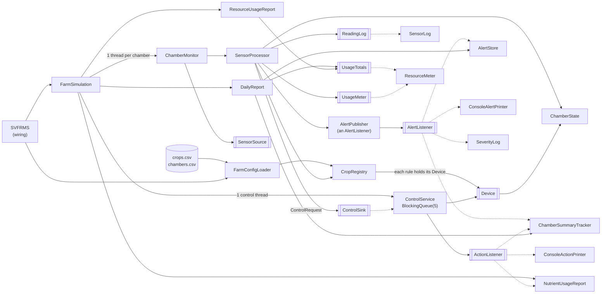
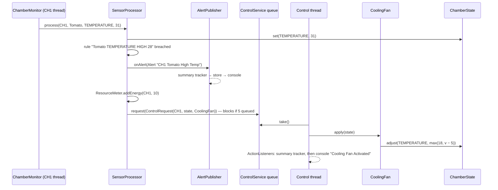

# SVFRMS – Refactoring the Singapore Vertical Farming Research Management System

**SE301 Project 2026-27 · G1 Team 3**
Team members: Etienne, Naren, Anson

<div style="page-break-after: always"></div>

**Build and run** (Java 25 or later, no external libraries):

```bash
java -jar run.jar                # runs one simulated day with the 4 legacy chambers
java -jar run.jar demo           # built-in demo layout (inside run.jar): adds Kale, Bok Choy, Bell Pepper (CH5-CH7) and Sensor Failure alerts
mvn package                      # rebuilds: runs the tests (78 methods, 90 runs) and writes target/run.jar
```

A run writes `archive/daily_report.txt` (legacy format), `archive/alerts_by_severity.txt` (every alert tagged INFO / WARNING / CRITICAL, see §5) `archive/sensor_log.txt` (every reading, timestamped), `archive/resource_usage.txt` (water and energy per chamber), `archive/nutrient_usage.txt` (nutrient doses per chamber) and `archive/weekly_crop_report.txt` (alerts, actions, water and energy per crop; all spec 3.5). Exit status: 0 = success, 1 = a chamber, the control thread or an alert listener failed, or a report file could not be saved, 2 = invalid configuration, 3 = internal error (a built-in resource missing or unreadable, a bad device list or a device registered twice). The full technical report is `README.pdf`.

Legacy line numbers below refer to the original file, kept unchanged at `baseline/legacy/org/example/SVFRMS.java` (393 lines).

---

## 1. Legacy System Analysis

**Purpose.** SVFRMS simulates one day of an indoor vertical farm. Each growing chamber holds one crop. Sensors read temperature, humidity, soil moisture, light and nutrient levels. When a reading is outside the crop's limits, the system raises an alert, charges water or energy, and asks a device (fan, pump, light…) to correct the chamber. At the end of the day it archives the alerts and writes a daily report to the console and to `archive/daily_report.txt`.

**Main components.** Everything lived in one class, `SVFRMS`:

| Component | Legacy lines | What it does |
|---|---|---|
| Global state | 7–31 | 5 lists, 2 maps, 4 counters, 4 lock objects, `Random`, all `public static` and mutable |
| Domain model | 33–46 | `ChamberState` (current readings) and `ChamberSummary` (alert/action counts) |
| Event hub | 62–88 | `handleEvent(type, …)`: six unrelated operations selected by a string |
| Rule engine | 141–205 | `processSensor`: an `if/else` matrix of sensor × crop |
| Device control | 90–129 | `activateControl`: an `if/else` chain over device names |
| Control queue | 131–139, 251–273 | hand-written bounded buffer (`wait/notifyAll`) and a `ControlThread` consumer |
| Simulation | 275–295 | `ChamberThread`: 20 cycles of 5 random readings per chamber |
| Reporting | 207–241, 309–347 | console report, alert archiving, file report |
| Bootstrap | 349–392 | `main` starts 4 chamber threads (Tomato, Strawberry, Lettuce, Chili), the control thread, and two report threads |

The intern added threads for performance: four chamber threads produce readings in parallel, and one control thread consumes device requests.

---

## 2. Code Analysis and Limitations

### 2.1 Design issues

| # | Issue | Legacy example | SOLID (spec 4.2) |
|---|---|---|---|
| S1 | **God class.** The model, rules, devices, queue, threads, reports and file I/O all live in one class | whole file | SRP (i) |
| S2 | **Global mutable state.** Every field is `public static`, so any code can change anything | 10–31 | SRP, DIP (v) |
| S3 | **String-typed event hub.** `handleEvent("CREATE_ALERT", chamber, "", msg)` does logging, storing, counting and printing. Callers pass dummy `""` arguments the branch ignores | 62–88, 142 | SRP (i), ISP (iv) |
| S4 | **Crop rules hard-coded in control flow.** The same alert block is copy-pasted **19 times**; adding a crop means editing `processSensor` in up to 3 places | 147–203 | **OCP (ii)** |
| S5 | **Magic numbers.** Thresholds, costs, device deltas and random ranges are scattered through the code | 94–124, 148–202, 285–292 | OCP |
| S6 | **Device `if/else` chain.** Adding a Heating Unit means editing `activateControl` | 90–129 | OCP, SRP |
| S7 | **Stringly-typed queue messages** `"CH1\|Cooling Fan"`, parsed again with `split` | 136, 269 | – |
| S8 | **Hand-written bounded buffer** that swallows `InterruptedException` (`catch(Exception e){}`) | 131–139, 256–267 | – |
| S9 | **`extends Thread`.** `ControlThread` ignores `interrupt()` and loops `while(true)`, so it does not behave the way callers of `Thread` expect | 251, 275 | **LSP (iii)** |
| S10 | **Concrete dependencies.** `System.out`, `new Date()` and a static `Random` are used directly, so a run can't be reproduced or tested | throughout | DIP (v) |
| S11 | **Duplicate report formatting** in the console and file versions | 210–214 vs 314–319 | SRP |
| S12 | **Dead code.** `irrigationCycle`, `feedingCycle`, `showAlerts`, `showLogs` and two unused locks | 243–249, 297–307 | – |

Example of S3 + S4. One Tomato rule; the same block is repeated for every crop and sensor:

```java
if(value>28){handleEvent("TRACK_ALERT", chamber, "", chamber+" Tomato High Temp");
             handleEvent("CREATE_ALERT", chamber, crop, chamber+" Tomato High Temp");
             totalEnergyUsage+=10; addControlRequest(chamber, "Cooling Fan");}
```

**LSP note.** The legacy code has no domain inheritance hierarchy. Its only inheritance is `extends Thread`, and S9 is the LSP problem there: code holding a `Thread` reference relies on `interrupt()` ending a blocked or looping thread (the cancellation contract `ExecutorService.shutdownNow()` and every interrupt-aware caller depend on). `ControlThread` is a `Thread` that breaks that postcondition, catching the interrupt and waiting again, so it cannot be substituted where a `Thread` is expected to be cancellable. We also avoided creating a new one: a `Device` base class with `increase()`/`decrease()` would force a Cooling Fan to implement a method that makes no sense for it.

### 2.2 Concurrency analysis (spec 4.4)

| # | Issue | Where | Effect |
|---|---|---|---|
| C1 | **Check-then-act on a `HashMap`** (`containsKey` → `put` → `get`) from 4 threads | 48–60 | `get` returns `null`, the chamber thread dies with an NPE, and a whole chamber can vanish from the report |
| C2 | **Unsynchronized `ArrayList.add`** from 4 threads | 64, 73 | lost alerts: `Generated Alerts` ≠ number archived |
| C3 | **Non-atomic counters** (`totalWaterUsage += n`) | 74–75, 148–186, 291 | lost updates to the water, energy and alert totals |
| C4 | **`ChamberState` written by a chamber thread and the control thread** with no lock | 146–198 vs 94–124 | a device's `temperature − 5` overwrites a newer reading, and there is no visibility guarantee |
| C5 | **`ChamberSummary`** read and written by two threads without synchronization | 79–86 | visibility; wrong counts through C1 |
| C6 | **Ordering race:** the archive and report threads start back-to-back (384–386). A lock gives mutual exclusion, not order | 373–389 | the report sometimes prints *before* archiving |
| C7 | **Locks that don't guard the writers:** `alertLock` is taken by the archiver but never by `handleEvent`, which adds to the list | 73, 208, 223 | a false sense of safety |
| C8 | **Unused locks:** `waterPumpLock` and `nutrientLock` are declared but never taken | 28–29 | suggests the pump and injector are guarded when nothing is |
| C9 | **Swallowed interrupts** in both `wait()` loops | 134, 258 | threads cannot be cancelled |
| C10 | **Deadlock in the control queue:** if the control thread dies (e.g. C1's NPE inside `activateControl`), chamber threads `wait()` forever on the full queue for a `notifyAll` only the dead consumer could send, and `main` waits forever in `join()` on them | 131–139, 251–273, 362–365 | no thread can proceed; the program never ends and writes no report |
| C11 | **Silent thread death:** no error handling, and `main` writes a "successful" report anyway | 362–391 | a corrupt report with no error |

One minor issue is left out of this table: C12, one shared `Random`, which is thread-safe but makes runs non-reproducible. The full list is in `docs/phase1-analysis.md`.

**Deadlocks.** *Reachable:* C10. Producers wait for a free slot that only the consumer can make, the consumer is gone, and `main` waits for the producers, so every remaining thread waits on another that will never act. Nothing times out, and the swallowed interrupts (C9) mean it cannot even be cancelled. *Latent lock-order deadlock:* the only nested locks are `alertLock` → `reportLock`, taken in the same order in both methods, so no cycle can form as written. It is one edit away, though: if either method took `reportLock` first, the two report threads could each hold one lock and wait for the other (the commented-out `sleep` calls at 224 and 385 widen exactly that window). The refactored design removes both (§3.3).

**Evidence.** We ran the unmodified program 300 times and checked invariants that must always hold. For example, water = 160 + the sum of the archived alerts' water costs, and `Generated Alerts` must equal the number of archived alerts (`baseline/check_invariants.py`):

```
Legacy: 92 / 300 runs with no defect
 123 thread crashed: NullPointerException   (C1)
  67 Generated Alerts != archived           (C2)
  27 / 24 water / energy lost update        (C3)
   7 report printed BEFORE archive          (C6)
```

### 2.3 Limitations kept on purpose

Spec section 4 says to preserve behaviour, so these legacy behaviours are kept unchanged. Each is now visible in one data row and can be changed without touching code:
- humidity rules exist only for Tomato and Strawberry, and the soil rule only for Tomato;
- light (< 500 lux) and nutrient (< 40%) limits are shared by all crops;
- low temperature triggers no device for the legacy crops;
- the legacy Cooling Fan (`max(18, v - 5)`) and Grow Light (`min(1000, v + 150)`) keep their exact formulas. A request runs on the control thread after the chamber may already have stored a newer reading, so a stale request can move that reading the wrong way (e.g. "Light level increased to 1000.0 lux" from 1150). The new devices never do this (`HeatingUnit` only heats); the same one-line guard would fix these two, but it would change legacy behaviour;
- Spinach and Cucumber have profiles but no chamber;
- the legacy crops use only the legacy devices. We added the three missing spec 3.3 devices (Heating Unit, Ventilation System, Shade Controller) as one class each, used only by the new Bell Pepper and Eggplant rows (§5); the Humidifier and Dehumidifier the spec doesn't list are kept;
- the legacy program has only the daily report: the Weekly Crop and Water / Energy / Nutrient Consumption reports of spec 3.5 never existed. We added all four without changing the daily report: Water Usage and Energy Consumption in `archive/resource_usage.txt`, Nutrient Consumption (Nutrient Injector doses) in `archive/nutrient_usage.txt`, each per chamber and total, and the Weekly Crop report in `archive/weekly_crop_report.txt` (§5). The program simulates one day per run, so the weekly report says it covers day 1 of 7 instead of inventing figures for the other six, which spec 4 would rule out. We did turn the sensor log the legacy code collected but never used into `archive/sensor_log.txt`, a record of the day's readings. (Severity levels and the sensor-failure alert from spec 3.4 were missing too; we added them without changing the legacy output, see §5.)

**Deliberate changes to legacy behaviour.** Two failure paths behave differently, because the legacy behaviour hid a defect; normal output is unchanged:
- *A failing alert listener.* Legacy: the exception escaped `handleEvent` and killed the chamber thread silently (C11), so the steps after it (store, print) never ran for that alert or any later one. Now `AlertPublisher` reports the failing listener, still delivers the alert to the others, and the run exits with status 1, since the report totals may be short.
- *A report that cannot be saved.* Legacy: it printed `Could not save archive report: …` and exited 0, so a script could not tell a lost report from a good run. The same line is still printed, but the run now exits with status 1. Status 3 (a built-in resource missing or unreadable, a bad device list or a device registered twice) separates a broken build from an invalid CSV (status 2).

---

## 3. Proposed Design

**Design rule:** preserve behaviour; remove each smell and concurrency defect above; add nothing else. Every class exists because it fixes a specific S# or C#.

### 3.1 Key changes and decisions

1. **Split the monolith into 7 small packages** (`model`, `crop`, `sensor`, `device`, `alert`, `report`, `app`): 50 small classes and interfaces, most under 100 lines. `org.example.SVFRMS` remains the entry point but only wires objects together (S1, S2, S15).
2. **Crop rules become data (S4, S5).** The 19 copy-pasted blocks became 19 rows in `src/main/resources/crops.csv`:
   ```
   # crop,  sensor,      dir,  limit, device,       water, energy, severity, message
   Tomato,  TEMPERATURE, HIGH, 28,    Cooling Fan,  0,     10,     CRITICAL, {crop} High Temp
   *,       LIGHT,       LOW,  500,   Grow Light,   0,     0,      INFO,     Low Light Level
   ```
   `SensorProcessor` loops over the rules for a crop and sensor and never names a crop:
   ```java
   for (ThresholdRule rule : crops.rulesFor(crop, sensor)) {
       if (!rule.isBreachedBy(value)) continue;
       alerts.onAlert(new Alert(chamberId, crop, rule.alertText(chamberId, crop), rule.severity()));
       resources.addWater(rule.waterCost());
       resources.addEnergy(rule.energyCost());
       if (rule.triggersDevice())
           control.request(new ControlRequest(chamberId, state, rule.device()));
   }
   ```
   *Decision:* a CSV resource instead of a Java "catalog" class. A catalog class would still have to be *edited* to add a crop, which is exactly what spec 4.2 (ii) asks to avoid. One small plain-Java class (`FarmConfigLoader`) reads the CSV; no library is needed. A bad row (wrong column count, unknown device or sensor, a duplicate chamber or rule) stops the program at start-up with the file and line number; a chamber whose crop has no rules gets a warning.
3. **One class per device** behind a `Device` interface (S6), with a `DeviceRegistry` that looks devices up by name (once, when `crops.csv` is loaded; a duplicate name is rejected).
4. **Typed objects instead of strings (S3, S7).** An `Alert` record goes to listeners; a `ControlRequest` record goes onto the queue.
5. **Dependencies are injected (S10).** `SensorSource` (random readings), the output and error `PrintStream`s and the `Clock` used for timestamps are passed in through constructors. The same code can then run with a seeded source, which is how we proved behaviour is unchanged.
6. **Dead code removed (S12).**

### 3.2 SOLID mapping (spec 4.2 i–v)

| Principle | Before | After |
|---|---|---|
| **(i) SRP** | `SVFRMS` did everything; `handleEvent` had 6 jobs | One job per class: `AlertStore` stores, `ConsoleAlertPrinter` prints, `ResourceMeter` counts, `DailyReport` formats. `ControlService` only queues and runs requests; the summary and the console lines are `ActionListener`s |
| **(ii) OCP** | A new crop meant editing 3 `if` chains | A new crop means new rows in `crops.csv`, with **zero** Java edits (§5). A new device is a new class |
| **(iii) LSP** | `ControlThread extends Thread` ignores `interrupt()` | No `Thread` subclasses: tasks are `Runnable`s run by an `ExecutorService`, and they honour interrupts. Every `Device` can honour the whole interface |
| **(iv) ISP** | One wide `handleEvent(type, chamber, crop, msg)`; callers pass dummy `""` | Small interfaces, each with 1–3 methods: `SensorSource`, `Device`, `AlertListener`, `ActionListener`, `ControlSink`, `UsageMeter`, `ReadingLog`, `UsageTotals`. `ResourceMeter` is split by client: chamber code charges it as a `UsageMeter`, the reports read it as `UsageTotals` |
| **(v) DIP** | Static fields, `System.out`, `new Date()`, static `Random` | The rule engine depends only on abstractions: `SensorProcessor` sends alerts to an `AlertListener`, charges a `UsageMeter`, queues on a `ControlSink` and logs readings to a `ReadingLog`; `ChamberMonitor` reads a `SensorSource`; `ControlService` runs any `Device` and tells `ActionListener`s; `DailyReport` and `ResourceUsageReport` read `UsageTotals`. Concrete objects are created only in `SVFRMS` (composition root). The `device` and `sensor` packages no longer depend on `report`: the interfaces they call (`ActionListener`, `UsageMeter`, `ReadingLog`) live with them, so `report` depends on them and never the other way |

### 3.3 Concurrency fixes

| Issue | Fix | Class |
|---|---|---|
| C1 | `ConcurrentHashMap.computeIfAbsent` creates a summary atomically. Each chamber thread owns its `ChamberState`, so state is no longer looked up at all | `ChamberSummaryTracker`, `ChamberMonitor` |
| C2 | `synchronized` methods on the alert store and the sensor log (its timestamp is formatted outside the lock) | `AlertStore`, `SensorLog` |
| C3 | `AtomicInteger.addAndGet`, one pair of counters per chamber created atomically by `computeIfAbsent`; the totals are their sum, so both reports read the same counters | `ResourceMeter` |
| C4, C5 | `synchronized set/adjust` on each chamber's state. A device's read-modify-write is one atomic `adjust(sensor, v -> max(18, v - 5))`; the Ventilation System changes two readings in one `changeAll` call. Reports read each summary as one `snapshot()` taken under its lock, so a report line never mixes two states | `ChamberState`, `ChamberSummary` |
| C6 | Archive, *then* report, in a fixed order on the main thread | `FarmSimulation` |
| C7 | Shared data is reachable only through its owner's methods, which hold that owner's lock | all of the above |
| C8 | Unused locks removed with the dead code (S12) | – |
| C9 | `ArrayBlockingQueue(5)` replaces the hand-written buffer; a `STOP` request queued behind pending work drains the queue before the consumer exits. Interrupts are never swallowed: a producer interrupted on a full queue keeps the flag and fails loudly (no request is lost silently), and if `STOP` can't be queued the consumer is interrupted instead. If the main thread is interrupted, the chamber threads are interrupted before the consumer, so none is left blocked on a full queue; each chamber checks the flag before every reading and stops, and the report waits for the chamber threads to stop (interrupting them after the 30 s timeout and waiting again), so none raises alerts after the report; one that stopped early is named as a partial day (a chamber that failed is reported once, with its error); and the report is still written | `ControlService`, `FarmSimulation` |
| C10 | Deadlock removed: the consumer catches a failure per request and keeps running, and if it dies anyway a waiting producer stops and fails (its timed `offer` checks the consumer is alive) instead of waiting forever; executors shut down with a 30 s timeout | `ControlService`, `FarmSimulation` |
| C11 | Each chamber's `Future` surfaces its exception: once every thread has stopped, it prints `ERROR: chamber CH2 failed: …` and the program exits with code 1. This happens even if the run was interrupted before reaching that chamber | `FarmSimulation` |

**No deadlock by construction.** No method holds two locks at once. Each lock guards a few field updates and is never held while calling another object. In particular, `SensorProcessor` holds no lock while it publishes an alert or waits for room in the control queue (a timed `offer` that also checks the control thread is still alive). With at most one lock held at any time, there can be no cycle of threads waiting on each other.

---

## 4. Final Architecture

### 4.1 Component diagram


`[[…]]` = interface. Device implementations: `CoolingFan`, `WaterPump`, `NutrientInjector`, `Humidifier`, `Dehumidifier`, `GrowLight`, `HeatingUnit`, `VentilationSystem`, `ShadeController`.

| Package | Classes |
|---|---|
| `app` | `FarmSimulation` (runs one day), `FarmConfigLoader`, `ChamberAssignment` |
| `model` | `SensorType` (enum), `ChamberState`, `ChamberSummary` |
| `crop` | `ThresholdRule`, `CropProfile`, `CropRegistry` |
| `sensor` | `SensorSource`, `RandomSensorSource`, `SensorProcessor`, `ReadingLog`, `UsageMeter`, `SensorRanges`, `ChamberMonitor` |
| `device` | `Device` + 9 devices, `DeviceRegistry`, `ControlRequest`, `ControlSink`, `ControlService`, `ActionListener`, `ConsoleActionPrinter` |
| `alert` | `Alert`, `Severity`, `AlertListener`, `AlertPublisher`, `AlertStore`, `ConsoleAlertPrinter` |
| `report` | `ChamberSummaryTracker`, `ResourceMeter`, `DailyReport`, `ResourceUsageReport`, `NutrientUsageReport`, `WeeklyCropReport`, `UsageTotals`, `DayEndOutput`, `SeverityLog`, `SensorLog`, `Timestamps` |

### 4.2 Sequence: one high-temperature reading in CH1



**End of the run** (`FarmSimulation.run`): wait for every chamber's `Future` → queue `STOP` (with a 30 s limit, so a hung device cannot block shutdown) so the control thread drains its queue and exits → check the control thread's own `Future`, so a crashed control thread fails the run → archive alerts → print the report → save `archive/daily_report.txt`, `alerts_by_severity.txt`, `sensor_log.txt`, `resource_usage.txt`, `nutrient_usage.txt` and `weekly_crop_report.txt`.

### 4.3 Proof that behaviour is preserved

- **Same output as the original.** The original program can't be reproduced with a fixed seed, because the scheduler decides which chamber draws the next random number. We ran both versions with the same seed and the chambers one at a time, then compared every alert line, total, chamber summary and archived alert. The output is **identical** in **42 / 42** comparisons: 21 seeds (1–20 and 42) × 2 layouts, the 4 legacy chambers and all six legacy crops (adding Spinach and Cucumber, which the legacy `main()` never schedules). `baseline/compare_refactor.sh` exits 1 on any difference. The invariant checker prices alerts from a cost table copied from the legacy source, not from our `crops.csv`.
- **Limits of this proof.** Device lines are compared as counts per chamber and device, because their values depend on control-thread timing. The concurrent run can only be checked against invariants, because the legacy concurrent output is different on every run. Archiving before printing the report is the order the legacy race produced in about 96% of runs; we made it the only order.
- **Concurrency.** The real concurrent `run.jar` passed the same invariant check in **300 / 300** runs with the legacy chambers and **300 / 300** with the 7-chamber `demo` layout, compared with 92 / 300 for the legacy program.
- **Tests.** 78 JUnit test methods (90 runs; the stress tests repeat 3 times): stress tests on every shared object (8 threads × 5,000 operations), the producer–consumer queue with capacity 1, a failing device (C10), a crashed control thread whose unrun requests are reported and fail the run, action listeners called in order (a failing one reported on its own), a heater that never lowers a newer reading, a `stop()` that gives up on a full queue, an interrupted producer (C9), a failing chamber (C11), including one whose run is interrupted before its error is collected, an interrupted run that still writes its report, an interrupted chamber that stops at its next cycle (or at the device request it was waiting to queue, without being counted as a failure), an alert listener that fails without hiding the alert from the others but still fails the run, a report that cannot be saved failing the run, the config loader's error cases, and end-to-end runs with exact totals (including the per-chamber usage, nutrient and weekly crop reports) for both chamber layouts, and a broken device list reported as an internal error.
- The baseline scripts run on Linux, macOS and Windows (Git Bash).

---

## 5. Extensibility and Maintainability

**Demonstration: adding Kale and Bok Choy (spec 4.5).** The complete change is 8 rows in `crops.csv` and 2 rows in a `chambers.csv`. No Java file changed. The chamber rows live in the demo layout (`src/main/resources/demo/chambers.csv`, packaged inside `run.jar`), so the default run keeps the legacy behaviour and `java -jar run.jar demo` runs the new crops:

```diff
+Kale,     TEMPERATURE, HIGH, 24, Cooling Fan, 0,  8, CRITICAL, {crop} High Temp
+Kale,     TEMPERATURE, LOW,  12, -,           0, 12, CRITICAL, {crop} Low Temp
+Kale,     HUMIDITY,    LOW,  55, Humidifier, 15,  0, WARNING,  {crop} Low Humidity
+Kale,     SOIL,        LOW,  40, Water Pump, 30,  0, WARNING,  {crop} Low Soil Moisture
+Bok Choy, ...                                           (4 similar rows)
 # demo/chambers.csv
+CH5, Kale
+CH6, Bok Choy
```

Both new crops automatically get the shared light and nutrient rules. With the 7 demo chambers, the program still passed 300 / 300 concurrent runs. **Removing a crop** means deleting its rows; if a chamber still uses it, that chamber keeps only the shared rules (as in the legacy code) and a start-up warning names the line. Bell Pepper (demo chamber CH7) and Eggplant (rules only, no chamber) were added the same way, and use the three new spec 3.3 devices: Heating Unit (low temperature), Ventilation System (high humidity) and Shade Controller (high light). Each device was one new class plus one line in `META-INF/services/org.example.device.Device` (found by `ServiceLoader`, so no existing class changed); because a request runs after the chamber may have stored a newer reading, they never move a reading the wrong way (a heater never cools).

**Changing crops without rebuilding.** `java -jar run.jar <folder>` uses `<folder>/crops.csv`, `chambers.csv` and `sensors.csv` in place of the built-in files when they exist, and prints which file it used. A chamber whose crop has no rows in `crops.csv` still runs with only the shared rules, as in the legacy code, but now prints a start-up warning, so a typo is visible. A row with an empty column, a limit that is not a finite number, a negative cost, or a second rule with the same crop, sensor, direction and limit (including a crop row that repeats a shared `*` row) stops the program with the file and line. The message is the last column, so it may contain commas. `java -jar run.jar demo` reads the demo layout built into the jar (`src/main/resources/demo`; a `demo` folder in the working directory takes priority): its `chambers.csv` adds `CH5, Kale`, `CH6, Bok Choy` and `CH7, Bell Pepper` for the presentation, and its `sensors.csv` models a light sensor that reads at most 1100 lux, so the demo also shows Sensor Failure alerts. Only a folder named on the command line is read, so a stray CSV can never change a normal run. Files saved by Notepad or PowerShell (byte-order mark, UTF-16, or appended with `>>`) are read correctly; any other non-UTF-8 text stops the program with the file name instead of being silently altered.

**Alerting extension (spec 3.4).** Each rule has a severity column (temperature CRITICAL; humidity, soil and nutrient WARNING; light INFO). A new `SeverityLog` listener writes every alert with its level, plus a count per level, to `archive/alerts_by_severity.txt`. A sensor that reports a reading outside its valid range in `sensors.csv` (e.g. NaN, humidity outside 0–100 %) or does not respond at all raises a CRITICAL *Sensor Failure* alert; the value is not stored, no device is triggered, and the chamber carries on with its other sensors. At the end of the run one extra console line gives the count per level, e.g. `Alerts by severity: INFO=21, WARNING=64, CRITICAL=93`. This took one new listener, one data file and one method in `SensorProcessor`. A second line gives the number of readings saved to `archive/sensor_log.txt`. Every legacy console line and the daily report are unchanged, so the legacy comparison still passes (it ignores the extension lines).

**Reporting extension (spec 3.5).** `ResourceMeter` now keeps water and energy per chamber (each charge names its chamber), and a new `ResourceUsageReport` (`DayEndOutput`) writes the Water Usage and Energy Consumption reports to `archive/resource_usage.txt`: one line per chamber and the total, read from the same counters as the daily report's totals. One console line sums it up, e.g. `Resource usage: water 840 L, energy 510 kWh across 4 chambers`. Saving it needed no change to `FarmSimulation` (it is one more `DayEndOutput` registered in `SVFRMS`), but per-chamber figures did need a one-time change underneath: `UsageMeter`'s methods now take the chamber id, so `ChamberMonitor` and `SensorProcessor` pass it on. The reports read the meter through the `UsageTotals` interface. The Nutrient Consumption report then needed no change to existing classes at all: `NutrientUsageReport` is one more `ActionListener` (it counts Nutrient Injector runs per chamber) and `DayEndOutput`, both registered in `SVFRMS`, writing `archive/nutrient_usage.txt` and e.g. `Nutrient usage: 27 Nutrient Injector doses across 4 chambers`. The Weekly Crop report was added the same way: `WeeklyCropReport` only reads `ChamberSummaryTracker` and `UsageTotals`, sums each chamber into its crop, and writes alerts, actions, water and energy per crop to `archive/weekly_crop_report.txt`, headed `Days recorded: 1 of 7 (one simulated day per run)`; console line e.g. `Weekly crop report: 4 crops, day 1 of 7`.

| Future change | Legacy | Refactored |
|---|---|---|
| Add or remove a crop | edit `processSensor` in up to 3 places | add or delete rows in `crops.csv` |
| Change a threshold or cost | find the right `if` among 19 copies | edit one number in one row |
| Add a device (e.g. Heating Unit) | edit `activateControl` | add `HeatingUnit implements Device`, list it in `META-INF/services/org.example.device.Device`, name it in a CSV row; no existing class changes (done for Heating Unit, Ventilation System, Shade Controller) |
| Add a report (e.g. weekly crop) | edit `main` and the report code | add a class that reads `UsageTotals` / `ChamberSummaryTracker` (or listens to alerts and actions) and implements `DayEndOutput`; register it in `SVFRMS`, `FarmSimulation` does not change (done for water and energy: `ResourceUsageReport`; for nutrients: `NutrientUsageReport`, an `ActionListener`; for crops per week: `WeeklyCropReport`) |
| Add an alert output (file log, SMS) | edit `handleEvent` | add an `AlertListener` and subscribe it (done for severity: `SeverityLog`) |
| Read real sensors | rewrite `ChamberThread` | add a `SensorSource` implementation |
| Change the report format | edit two places | edit `DailyReport` only |
| Add a chamber | edit `main` | add a row to `chambers.csv`, or run with a config folder |

**Maintainability.**
- Each class has one job. Most are under 100 lines; the largest (`FarmConfigLoader`, `FarmSimulation`, `ControlService`) are long because of input checks and shutdown handling, not extra responsibilities.
- Names describe the domain (`AlertStore`, `ResourceMeter`) instead of string codes.
- Thread-safety lives inside the class that owns the data, so callers can't forget a lock.
- The single-lock rule (§3.3) is documented in `SensorProcessor`, so future changes keep the program deadlock-free.
- The baseline scripts let any future change be checked against the original behaviour.

---

## 6. Design Patterns

| Pattern | Where | Problem it solves | Why this pattern |
|---|---|---|---|
| **Strategy** | `Device` interface + 9 device classes, used by `ControlService` | The `activateControl` `if/else` chain over device names (S6): every new device meant editing it | Each device is a different algorithm for changing a chamber's state behind one interface. `ControlService` runs any `Device` without knowing which one, so a new device is one new class |
| **Observer** | `AlertPublisher` notifies `ChamberSummaryTracker`, `AlertStore`, `ConsoleAlertPrinter` (all `AlertListener`) | `handleEvent` did tracking, storing, counting and printing behind one string switch (S3: SRP, ISP) | The rule engine raises one `Alert` and does not know who listens. Each listener has one job, and a new reaction is a new listener: severity was added this way (`SeverityLog`). Listeners are called in registration order, which preserves the legacy output order; a listener that throws is reported on its own, the rest still run, and the run fails (the report may be short). `CopyOnWriteArrayList` makes the listener list safe to read from many threads. Device actions use the same pattern (`ActionListener`: summary tracker, console printer, nutrient report), so `ControlService` no longer depends on the report |
| **Command** | `ControlRequest` (chamber + state + device, with `execute()`) | Queue messages were strings like `"CH1\|Cooling Fan"`, parsed again with `split` (S7) | A request is an object that carries everything needed to run later on another thread, so there's no string parsing and no lookup by chamber name |
| **Producer–Consumer** | `ControlService`: chamber threads `put`, the control thread `take`s from an `ArrayBlockingQueue(5)` | A hand-written `wait/notifyAll` buffer that swallowed interrupts and could hang (S8, C9, C10) | Same bounded-buffer behaviour as the legacy code (capacity 5, producers block when full), using the JDK's tested implementation |
| **Registry** | `CropRegistry`, `DeviceRegistry` | Crop and device names hard-coded in control flow (S4, S6) | Looking an object up by name is all that is needed; it lets CSV rows refer to devices by name and catches typos at start-up. `DeviceRegistry.discover()` fills itself with `ServiceLoader` from `META-INF/services`, so adding a device edits no existing class |
| **Composition root / constructor injection** | `SVFRMS.createSimulation` | Global `static` state (S2) and concrete dependencies (S10) | Every object is created once and passed in, so there are no globals, and a seeded `SensorSource` can be injected to check behaviour |

**Patterns not used, on purpose.**
- **Strategy per crop.** Crops differ only in numbers, not in behaviour, so data (CSV rows) is simpler than one class per crop.
- **Singleton.** It would bring back the global state that caused S2 and most of the concurrency bugs.
- **Factory / Abstract Factory.** No family of related objects needs to be created.
