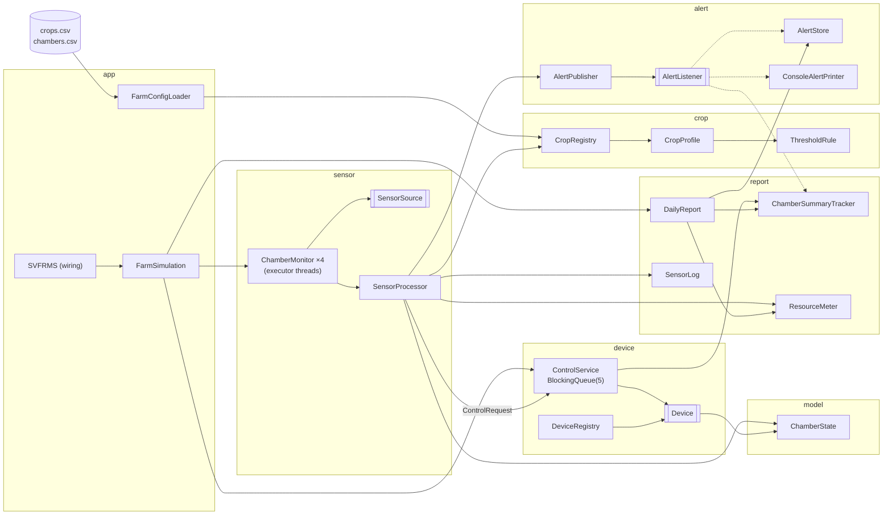
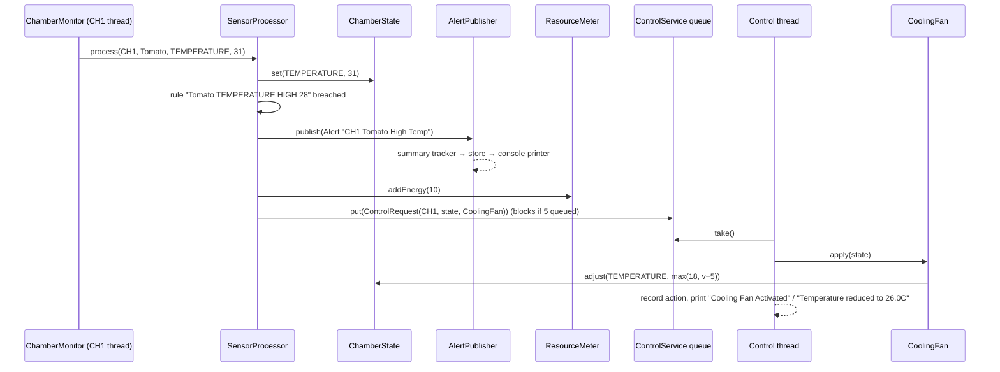

# Phase 2 – Proposed Design

Design rule (agreed in Phase 1): **preserve behaviour, fix the smells and concurrency defects the spec asks about, add nothing else.** Every class below exists because it removes a specific smell (S#) or concurrency issue (C#) from [phase1-analysis.md](phase1-analysis.md).

---

## 1. Package structure

```
src/main/java/org/example/
├── SVFRMS.java                 entry point + wiring (composition root)
├── app/
│   ├── FarmSimulation.java     runs one simulated day: start → monitor → stop → archive → report → save
│   ├── ChamberAssignment.java  record: chamber id + crop name
│   └── FarmConfigLoader.java   reads crops.csv and chambers.csv from the classpath
├── model/
│   ├── SensorType.java         enum TEMPERATURE, HUMIDITY, SOIL, LIGHT, NUTRIENT (+ legacy random range)
│   ├── ChamberState.java       current readings of one chamber (thread-safe)
│   └── ChamberSummary.java     alert/action counts of one chamber (thread-safe)
├── crop/
│   ├── ThresholdRule.java      record: sensor, HIGH/LOW, limit, device, water cost, energy cost, message
│   ├── CropProfile.java        a crop name + its rules
│   └── CropRegistry.java       crop name → profile, plus rules shared by every crop
├── sensor/
│   ├── SensorSource.java       interface: double read(SensorType)
│   ├── RandomSensorSource.java legacy random readings (seedable)
│   ├── SensorProcessor.java    legacy processSensor: log, update state, check rules, raise alert, charge cost, request device
│   └── ChamberMonitor.java     Runnable: 20 cycles of 5 readings for one chamber
├── device/
│   ├── Device.java             interface: name() + apply(ChamberState) → log text
│   ├── CoolingFan.java  WaterPump.java  NutrientInjector.java
│   ├── Humidifier.java  Dehumidifier.java  GrowLight.java
│   ├── DeviceRegistry.java     device name → Device
│   ├── ControlRequest.java     Command: "run this device on this chamber"
│   └── ControlService.java     bounded BlockingQueue: producers = chambers, consumer = control thread
├── alert/
│   ├── Alert.java              record: chamber, crop, message
│   ├── AlertListener.java      interface: onAlert(Alert)
│   ├── AlertPublisher.java     notifies listeners in registration order
│   ├── AlertStore.java         active + archived alerts, generated count (thread-safe)
│   └── ConsoleAlertPrinter.java prints "[CH1][Tomato][ALERT] ..."
└── report/
    ├── ChamberSummaryTracker.java per-chamber summaries (alert listener + action recorder)
    ├── ResourceMeter.java      water / energy totals (atomic)
    ├── SensorLog.java          timestamped reading log (kept: Q11)
    └── DailyReport.java        archive step, console report, file report – one place for the format

src/main/resources/
├── crops.csv                   every crop rule (the legacy if/else chains, as data)
└── chambers.csv                which crop runs in which chamber
```

This comes to about 30 files. Most are under 30 lines: 6 are one-device classes, and 6 are records, enums or one-method interfaces. Each file has one job that a student can explain in a sentence.

---

## 2. Crop rules as data (the fix for spec 4.2 ii / 4.5)

All 19 copied alert blocks (S4, S5) become rows in **`crops.csv`**. The rows below are the complete legacy behaviour, with values copied from lines 147–203:

```csv
# crop,       sensor,      dir,  limit, device,            water, energy, message
Tomato,       TEMPERATURE, HIGH, 28,    Cooling Fan,       0,     10,     {crop} High Temp
Tomato,       TEMPERATURE, LOW,  22,    -,                 0,     15,     {crop} Low Temp
Tomato,       HUMIDITY,    HIGH, 80,    Dehumidifier,      0,     0,      {crop} High Humidity
Tomato,       HUMIDITY,    LOW,  60,    Humidifier,        20,    0,      {crop} Low Humidity
Tomato,       SOIL,        LOW,  45,    Water Pump,        50,    0,      {crop} Low Soil Moisture
Strawberry,   TEMPERATURE, HIGH, 24,    Cooling Fan,       0,     10,     {crop} High Temp
Strawberry,   TEMPERATURE, LOW,  18,    -,                 0,     15,     {crop} Low Temp
Strawberry,   HUMIDITY,    HIGH, 85,    Dehumidifier,      0,     0,      {crop} High Humidity
Strawberry,   HUMIDITY,    LOW,  70,    Humidifier,        25,    0,      {crop} Low Humidity
Lettuce,      TEMPERATURE, HIGH, 21,    Cooling Fan,       0,     0,      {crop} High Temp
Lettuce,      TEMPERATURE, LOW,  15,    -,                 0,     0,      {crop} Low Temp
Spinach,      TEMPERATURE, HIGH, 20,    Cooling Fan,       0,     0,      {crop} High Temp
Spinach,      TEMPERATURE, LOW,  10,    -,                 0,     0,      {crop} Low Temp
Chili,        TEMPERATURE, HIGH, 32,    Cooling Fan,       0,     0,      {crop} High Temp
Chili,        TEMPERATURE, LOW,  24,    -,                 0,     0,      {crop} Low Temp
Cucumber,     TEMPERATURE, HIGH, 27,    Cooling Fan,       0,     0,      {crop} High Temp
Cucumber,     TEMPERATURE, LOW,  18,    -,                 0,     0,      {crop} Low Temp
*,            LIGHT,       LOW,  500,   Grow Light,        0,     0,      Low Light Level
*,            NUTRIENT,    LOW,  40,    Nutrient Injector, 0,     0,      Low Nutrient Level
```

- `HIGH` means `value > limit`, and `LOW` means `value < limit`, the same strict comparisons as the legacy code.
- `*` rows apply to every crop; these are the global light and nutrient thresholds (Q3). Their messages have no crop name, as in the legacy code.
- The alert text is `chamberId + " " + message`, with `{crop}` replaced by the crop name. This gives exactly the legacy strings, such as `CH1 Tomato High Temp` and `CH3 Low Light Level`.
- `-` means "no device". This is legacy Q5: low temperature triggers nothing.
- Every quirk (Q1–Q6) is now visible at a glance. For example, Lettuce has no humidity rows.

**`chambers.csv`**: `CH1,Tomato` · `CH2,Strawberry` · `CH3,Lettuce` · `CH4,Chili`. Spinach and Cucumber have profiles but no chamber (Q6).

**Adding Kale** means adding two or more rows to `crops.csv` (and a line in `chambers.csv` if it should run). **Removing a crop** means deleting its rows. No Java file changes in either case.

> **Decision D1 – CSV resource vs a Java class.** The alternative was a `CropCatalog.java` with one builder call per crop. That is just as readable, but adding a crop would *edit an existing class*, and spec 4.2 (ii) asks exactly whether that is needed. A CSV read by about 40 lines of plain Java (`BufferedReader` + `split(",")`) is the smallest thing that answers "no". No library is used.

---

## 3. Key interfaces

```java
public interface SensorSource {            // DIP: the processor doesn't know readings are random
    double read(SensorType type);
}

public interface Device {                  // Strategy: one implementation per device
    String name();                         // "Cooling Fan"
    String apply(ChamberState state);      // changes the state, returns "Temperature reduced to 19.0C"
}

public interface AlertListener {           // Observer
    void onAlert(Alert alert);
}
```

Example device: the legacy branch at lines 93–98, now in its own class.

```java
public class CoolingFan implements Device {
    public String name() { return "Cooling Fan"; }
    public String apply(ChamberState state) {
        double t = state.adjust(SensorType.TEMPERATURE, v -> Math.max(18, v - 5));
        return "Temperature reduced to " + t + "C";
    }
}
```

`ChamberState.adjust` is `synchronized`, so the read-modify-write is atomic (C4). The device does not need to know about locks.

`ControlService` prints `"<name> Activated"` and then the text returned by `apply`, and updates the chamber summary. Every device shares that logic, so it is written once, which removes the triplicated `handleEvent` calls in S6.

---

## 4. Design patterns (spec 4.3)

| Pattern | Where | Problem it solves (legacy smell) | Why this pattern and not something bigger |
|---|---|---|---|
| **Strategy** | `Device` + 6 implementations (7 now: `HeatingUnit` was added later as one class plus one registration) | `activateControl` if/else over device names (S6). Adding Heating Unit meant editing that method | Each device is a different algorithm behind one interface. Adding a device = one class + one registry line. ControlService never changes |
| **Registry** | `CropRegistry`, `DeviceRegistry` | Crop names and device names hard-coded in control flow (S4, S5, S7) | A lookup by name is all that is needed. No factory hierarchy |
| **Observer** | `AlertPublisher` → `ChamberSummaryTracker`, `AlertStore`, `ConsoleAlertPrinter` | `handleEvent` did summary, storage, counting and printing behind one string switch (S3: SRP, ISP) | The rule engine raises one `Alert`; each listener does one job. New outputs (a file log, severity, SMS) = a new listener |
| **Command** + **Producer–Consumer** | `ControlRequest` on an `ArrayBlockingQueue` in `ControlService` | `"CH1\|Cooling Fan"` strings parsed with `split` (S7); hand-written `wait/notifyAll` buffer that swallowed interrupts (S8, C9) | The request carries the device and the chamber's state as objects and has `execute()`. The JDK's `BlockingQueue` provides the bounded buffer (capacity 5, as in the legacy code) |

**Not used on purpose:**
- **Strategy per crop.** Crops differ only in numbers, not in behaviour, so data is simpler (D1).
- **Singleton.** It would recreate the global state of S2. Objects are created once in `SVFRMS.main` and passed in through constructors.
- **Factory or Abstract Factory.** Nothing needs a family of products.

---

## 5. SOLID mapping (spec 4.2 i–v)

| Spec | Legacy problem | Design change |
|---|---|---|
| **(i) SRP** – multiple unrelated responsibilities | `SVFRMS` did everything (S1); `handleEvent` had 6 jobs (S3); report format duplicated (S11) | One job per class (see the package list). All report formatting lives only in `DailyReport` |
| **(ii) OCP** – new crop needs code changes? | Yes: 3 places in `processSensor` (S4) | No: rows in `crops.csv`. `SensorProcessor` loops over `profile.rulesFor(sensor)` and never names a crop. Devices are open for extension via `Device` |
| **(iii) LSP** – inheritance that breaks expectations | `ControlThread extends Thread` and ignores `interrupt()` (S9) | No `Thread` subclasses: tasks are `Runnable`s run by an `ExecutorService`. The consumer exits on `InterruptedException` and restores the flag. `Device` has only methods every device can honour (no `increase()/decrease()` pair a fan can't implement) |
| **(iv) ISP** – large interfaces | `handleEvent(type, chamber, crop, message)` was one wide entry point; callers passed dummy `""` | Three tiny interfaces (`SensorSource`, `Device`, `AlertListener`), each with 1–2 methods. Callers depend only on what they use |
| **(v) DIP** – depend on abstractions | Static fields, `System.out`, a static `Random` (S2, S12) | `SensorProcessor` depends on `AlertListener`/`AlertPublisher` and `Device`, not on the concrete printer or devices. `SensorSource` and `PrintStream` are injected, so the baseline harness can pass a seeded source |

---

## 6. Architecture diagrams

### Component diagram


`[[...]]` marks an interface.

### Sequence: one high-temperature reading in CH1



The order of effects (summary → store → print → cost → device) is the same as the legacy code.

### End of run

`FarmSimulation.run()`:
1. Starts the control consumer.
2. Submits one `ChamberMonitor` per chamber and waits on each `Future` (an exception is reported, not swallowed: C11).
3. Calls `controlService.shutdown()`, which queues a stop request *behind* all pending requests, so the queue drains first (legacy semantics).
4. Archives alerts, **then** prints the daily report, on the main thread in a fixed order (C6, Q8).
5. Prints "System finished sensor processing." and saves `archive/daily_report.txt`.

---

## 7. Concurrency design (spec 4.4)

| Issue | Fix | Tool |
|---|---|---|
| C1 `HashMap` check-then-act | Summaries created with `computeIfAbsent`, which is atomic. Chamber state is no longer looked up at all: each monitor owns its `ChamberState` and passes the reference inside each `ControlRequest` | `ConcurrentHashMap` |
| C2 unsynchronized `ArrayList` | `AlertStore` methods are `synchronized`; `SensorLog` methods are `synchronized` too | intrinsic lock |
| C3 non-atomic counters | water/energy in `ResourceMeter` | `AtomicInteger.addAndGet` |
| C4 `ChamberState` read-modify-write | `set` and `adjust` are `synchronized` on the state object | intrinsic lock (one per chamber) |
| C5 `ChamberSummary` visibility | `recordAlert` / `recordAction` / getters are `synchronized` | intrinsic lock (one per chamber) |
| C6 archive vs report race | Run sequentially, archive first | program order |
| C7 locks that don't guard the writers | Every shared field is touched only through its owner's methods, which hold that owner's lock | encapsulation |
| C8 unused locks | Removed | – |
| C9 swallowed interrupts | `catch (InterruptedException e) { Thread.currentThread().interrupt(); return; }` | – |
| C10 dead consumer → hang | The consumer catches a `RuntimeException` per request, reports it and keeps going; the executors are shut down with a timeout | `ExecutorService.awaitTermination` |
| C11 silent thread death | `Future.get()` rethrows the chamber's exception; `main` reports it and exits non-zero | `ExecutorService` + `Future` |
| C12 shared `Random` | Kept for identical behaviour; `SensorSource` is injected, so a test can pass a seeded source | – |

**Deadlock freedom by construction.** No method holds two locks at once. Each lock (`ChamberState`, `ChamberSummary`, `AlertStore`, `SensorLog`) is held only for a few field updates and never while calling out to other objects. In particular, `SensorProcessor` releases the state lock *before* publishing an alert or calling the blocking `queue.put`. With at most one lock held at any time, the lock-wait graph cannot contain a cycle. Section 7 of the README will state this rule so future changes keep it.

---

## 8. Behaviour preservation and how we verify it

The following stay exactly as in the legacy code:
- every alert string;
- the `[..][..][ALERT]` and green `[CONTROL]` console formats;
- device deltas and limits;
- costs (+2 L / +1 kWh per cycle, plus the per-rule costs);
- the sensor random ranges and the order of draws (T, H, S, L, N × 20);
- initial state values;
- queue capacity 5;
- summaries created only on the first alert or action;
- the report and file layout, including the literal `Daily Report` log entry.

**Verification.** `baseline/RefactoredHarness.java` wires the new classes with a `RandomSensorSource(new Random(42))` and a **single-thread** chamber executor, the same serial schedule as the legacy harness. Its output goes through the same `normalize.py` and must `diff` cleanly against `baseline/expected/seed42-normalized.txt`. The real app keeps four concurrent chambers. Running the invariant checker 300 times against it must give 300/300 OK, where the legacy code gave 92/300.

---

## 9. What changes for a future developer

| Task | Legacy | New design |
|---|---|---|
| Add a crop (Kale) | edit `processSensor` in up to 3 places | add rows to `crops.csv` |
| Remove a crop | delete branches, hope nothing else refers to it | delete its rows |
| Change a threshold | find the right `if` among 19 copies | edit one number in one row |
| Add a device (Heating Unit) | edit `activateControl` | add `HeatingUnit implements Device`, register it, reference it in a CSV row |
| Add an alert output (file, severity) | edit `handleEvent` | add an `AlertListener` |
| Change the report format | edit two places | edit `DailyReport` |
